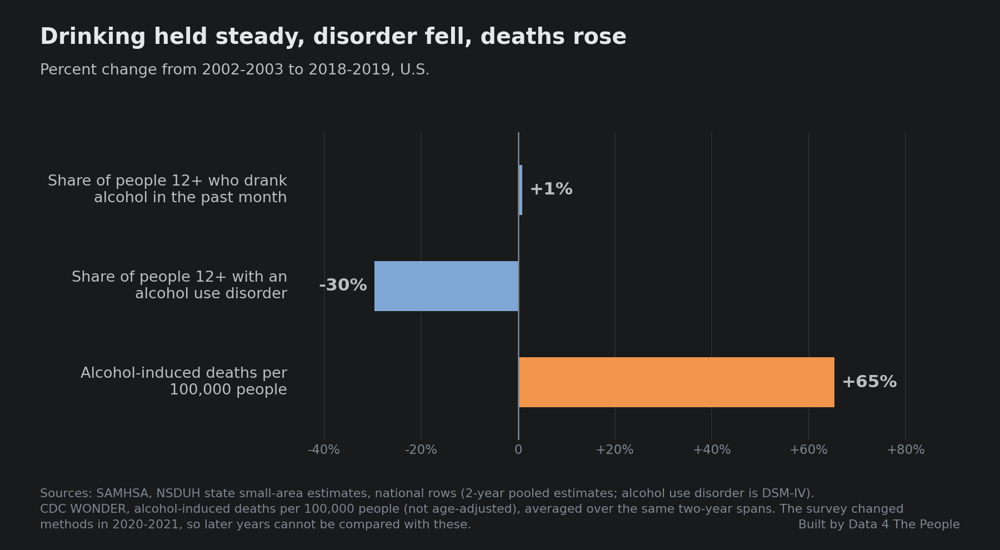
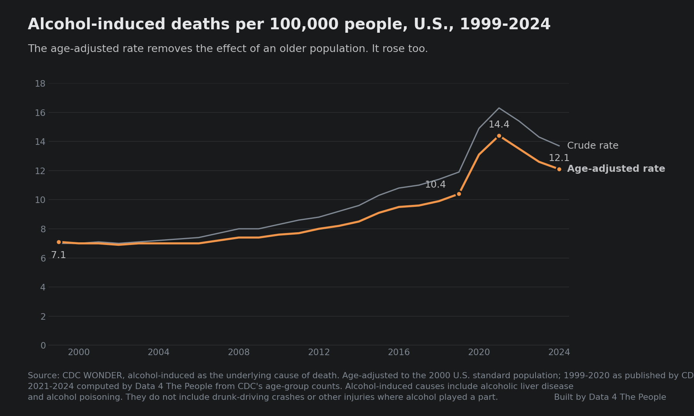
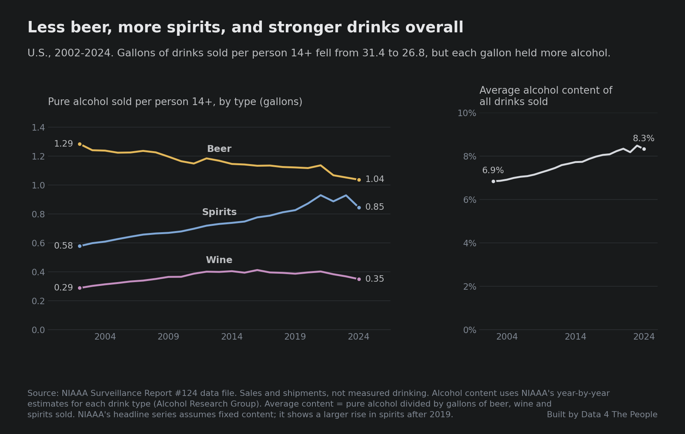
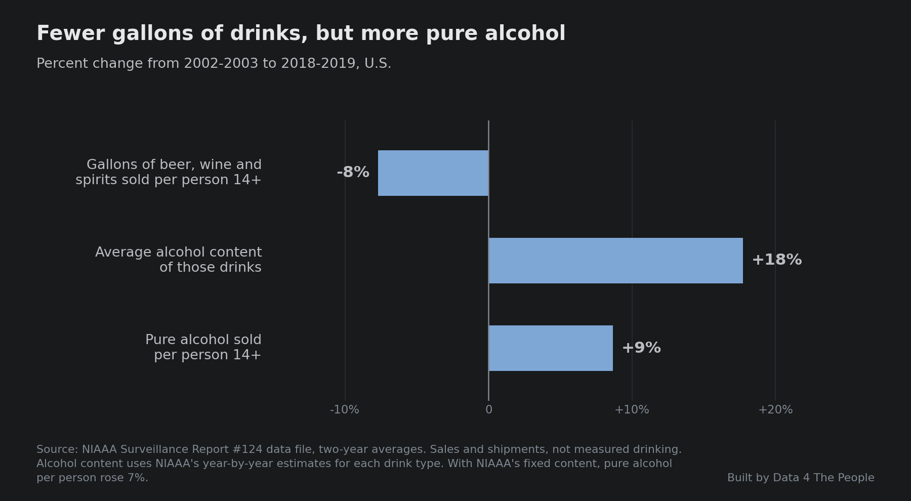

# Alcohol: Less Alcoholism, More People Dying

Alcohol use in America is going down.

Right?

I’ve been a passive consumer of media on this topic, seeing random [headlines](https://news.gallup.com/poll/693362/drinking-rate-new-low-alcohol-concerns-surge.aspx) in passing. Over time, these headlines created that story in my mind that alcohol use in America is in structural decline.

But then I spent some time studying Jameson’s [Substance Use Disorder (SUD) map](https://www.data4thepeople.com/p/substance-use-treatment-viz) and realized my reckless passive consumption of media on this topic created a flawed story in my mind.

So here is what you need to know. The headlines are right. Alcoholism is down, as measured by the share of Americans with an alcohol use disorder. In fact, it fell 30% in the 16 years before the pandemic. And over the same years, alcohol became far more deadly – killing 65% more people per capita.

*Sources: SAMHSA, National Survey on Drug Use and Health state estimates; CDC WONDER.*

I was shocked when I saw this data, because none of the headlines ever mentioned it. How can the death rate from alcohol be up so much at the same time alcoholism is in decline?

I immediately assumed it must be age. Twenty years ago, America was far younger, with a median age of just 36.1. Now America’s median age is 39.1. The same is true of Americans with an alcohol use disorder: the share who are 26 or older rose from 61% in 2002-2003 to 75% in 2018-2019, as rates among teens and young adults fell fastest. So, it’s the cumulative impact of alcohol consumption that is leading to more deaths? Only partly. As the chart below shows, when you age adjust the data, most of the rise is still there: deaths per capita rose 46% after adjusting for age, compared with 65% before.

*Source: CDC WONDER, alcohol-induced deaths. Age-adjusted to the 2000 U.S. standard population.*

In fact, when I studied the data, I found one pattern that stands out.

Mix.

Remember, our old friend, mix? I’ve written about it in the context of America’s [demographics](https://www.data4thepeople.com/p/america-has-a-mix-problem) and [education](https://www.data4thepeople.com/p/educational-attainment). Well, mix is showing up here too. America’s taste for alcohol is moving from beer to spirits. Spirits have a far higher alcohol content than beer, so even though Americans bought fewer gallons of beer, wine and spirits per person, they bought about 9% more pure alcohol per person over the same years as the first chart.

*Source: NIAAA Surveillance Report #124 data file. Sales and shipments, not measured drinking.*

Here is how fewer gallons added up to more pure alcohol.

*Source: NIAAA Surveillance Report #124 data file. Sales and shipments, not measured drinking.*

Ultimately, we can’t wrap a neat and tidy answer bow around this topic, which is why it’s a perfect Data 4 Thought topic. But what we can say is this: if the ultimate arbiter of success in fighting alcoholism is life and death, America is doing far worse in this area than many think.

## About the data

- **Alcohol use disorder and drinking.** SAMHSA's National Survey on Drug Use and Health, state small-area estimates, national rows, people 12 and older. Each estimate pools two survey years. We compare 2002-2003 with 2018-2019 because the survey changed how it is given in 2020 and how it measures alcohol use disorder in 2021, so later years cannot be compared with earlier ones. SAMHSA does not publish a median age for people with an alcohol use disorder, so we use the share who are 26 or older.
- **Deaths.** CDC WONDER, deaths whose underlying cause is alcohol-induced, such as alcoholic liver disease or alcohol poisoning. These do not include drunk-driving crashes or other injuries where alcohol played a part. Age-adjusted rates use the 2000 U.S. standard population. For 2021-2024 we age-adjusted CDC's counts ourselves; the same method matches CDC's published rates within 0.06 per 100,000 in every year from 1999 to 2020.
- **Alcohol sold.** NIAAA Surveillance Report #124. These are sales and shipments, not measured drinking. They include alcohol bought by tourists and across state lines, and leave out homemade and illegal alcohol. Alcohol content uses NIAAA's year-by-year estimates for each drink type. NIAAA's headline series assumes fixed alcohol content and shows a 7% rise in pure alcohol per person instead of 9%.
- **Median age.** U.S. Census Bureau population estimates for 2004 and 2024.
- **What this does not tell you.** These are national totals. They show that deaths rose while alcohol use disorder fell and the mix of drinks changed. They do not show why any one person died, or how much of the rise in deaths the change in mix explains.
- **Method, code and data:** [github.com/Data4ThePeople/SUD_V3](https://github.com/Data4ThePeople/SUD_V3), in `DATASETS.md` and `scripts/alcohol/`.
